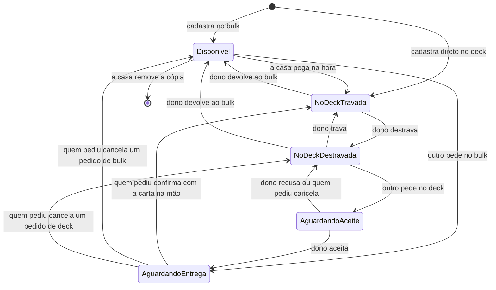

# Spec do backend

O que este repositório precisa implementar para sustentar o app descrito em [conceito.md](conceito.md). A interface não faz parte daqui. A pasta `docs/` é documentação do produto; `GET /docs` da API continua sendo o Swagger do FastAPI.

## Stack

- Python 3.13, FastAPI, Pydantic, SQLAlchemy 2 assíncrono, Alembic, PostgreSQL, UV.
- Testes com pytest. Estilo já exigido por Ruff e Mypy.
- Prefixo `/api/v1`.
- Dinheiro em centavos, inteiro. R$ 10 são `1000`. Nunca `float`.
- Auth no Supabase. Domínio (nick, grupos, cartas, decks, pedidos) no PostgreSQL deste serviço.

Variáveis novas, no mesmo padrão de `app/core/config.py`: URL e chave anônima do Supabase, JWT secret ou JWKS para validar o access token, e a service role só no processo do backend. A service role não vai para o cliente nem para o log.

## Autenticação

O Supabase Auth entra com e-mail e senha. Não existe login nativo por nick. O nick único mora na tabela `users` deste banco, com o `id` igual ao `user.id` do Supabase.

Cadastro:

1. Nick livre, comparação sem diferença de maiúsculas.
2. Cria o usuário no Supabase com e-mail, senha e o nick nos metadados.
3. Grava `users` (`id`, `email`, `nick`, `created_at`).
4. Nick duplicado falha o cadastro inteiro.

Nick: 3 a 20 caracteres, letras, números e `_`, único ignorando caixa.

Login: o corpo leva `identifier` e `password`. Se o identifier contém `@`, é e-mail. Caso contrário, o backend acha o e-mail pelo nick e chama o Supabase. A resposta de erro é a mesma para nick inexistente e senha errada. A resposta de sucesso devolve os tokens do Supabase e não devolve o e-mail quando o login foi por nick.

Rotas protegidas exigem `Authorization: Bearer`. O backend valida assinatura, emissor e expiração do JWT e carrega o `users` local. Usuário sem linha local recebe 401.

Recuperação de senha: o cliente manda e-mail ou nick. O backend pede o e-mail de reset ao Supabase e responde sempre a mesma mensagem, exista a conta ou não.

Endpoints:

- `POST /auth/register` com `email`, `password`, `nick`
- `POST /auth/login` com `identifier`, `password`
- `POST /auth/refresh` com `refresh_token`
- `POST /auth/forgot-password` com `identifier`
- `GET /me`

`GET /me` devolve `id` e `nick`.

## Modelo

### users

`id` uuid, `email`, `nick`, `nick_normalized` único, `level` (0 é admin, 1 é usuário comum, o padrão do cadastro público), `created_at`.

O admin `bulkados` é criado na subida do backend, se ainda não existir, com `ADMIN_EMAIL` e `ADMIN_PASSWORD` (em desenvolvimento, sem senha configurada, vale `@bulkados1234`). O nick `bulkados` é reservado no cadastro público. `POST /admin/users` cria usuário, com `level` opcional.

### groups

`id`, `name`, `owner_id`, `created_at`.

### group_members

`group_id`, `user_id`, `status` (`invited`, `accepted`), `invited_by`, `created_at`. Único por grupo e usuário.

Dono é membro `accepted`. Só gente `accepted` vê e mexe no grupo.

### catalog_cards

Acervo das cartas do Scryfall, uma linha por Oracle ID. Não é a cópia física. É carregado inteiro pela atualização do acervo (veja `catalog_sync`); antes da primeira carga, a busca ainda grava aqui o que encontra no Scryfall.

`oracle_id` único, `name_en`, `name_pt` nulo se o Scryfall não tiver impressão em português, `search_en` e `search_pt` (o nome sem acento, em minúsculas e sem pontuação, indexados para a busca por prefixo), `mana_cost` nulo, `image_url` nulo (a imagem `normal` do Scryfall, só o link), `type_line`, `oracle_text`, `color_identity`, `keywords`, `is_basic`, `any_number_allowed`, `commander_legal` (`legal`, `banned`, `not_legal`), `can_be_commander`, `partner_kind` nulo ou um de `partner`, `partner_with`, `friends_forever`, `background`, `choose_a_background`, `doctors_companion`.

`can_be_commander` é verdadeiro para criatura lendária e para carta cujo texto permite ser comandante. O pareamento (Partner, Background, etc.) fica em `partner_kind`, lido das keywords e do oracle text em inglês do Scryfall. A interface mostra o nome em português quando existir e o nome em inglês como alternativa.

### catalog_sync

Uma única linha (`id = 1`) com o estado da atualização do acervo: `interval_days` (padrão 90), `last_synced_at` nulo até a primeira carga, `running_since` (preenchido enquanto uma atualização roda, e dado como morto depois de 1 hora) e `last_error` (o último erro, ou nulo).

### card_copies

Uma linha por papel.

`id`, `catalog_card_id`, `holder_id` (a casa), `added_by_id`, `price_cents` nulo se o preço não veio, `price_fetched_at`, `state` (`available`, `reserved`, `in_deck`), `locked`, `deck_id` nulo, `created_at`.

Land básica grava `price_cents = 0` e não chama o provedor de preço. Básicas: Plains, Island, Swamp, Mountain, Forest, Wastes e as snow-covered equivalentes.

Invariantes:

- `available`: `deck_id` nulo, `locked` falso, nenhum pedido aberto.
- `reserved`: `locked` verdadeiro, um único pedido aberto.
- `in_deck`: `deck_id` preenchido com deck do detentor atual depois da confirmação. Durante um pedido que saiu de um deck, a cópia pode continuar naquele deck até a confirmação; o estado fica `reserved` e o pedido guarda o deck de origem. `deck_id` na cópia, nesse intervalo, continua o deck de origem.

Uma cópia tem no máximo um pedido aberto. Índice único parcial em `card_copy_id` onde o pedido está aberto.

### card_copy_groups

`card_copy_id`, `group_id`. A cópia aparece nesses grupos. A trava não é por linha: é a da cópia.

O detentor da casa é membro `accepted` de cada grupo vinculado. Ao sair do grupo, apagam-se os vínculos daquele grupo para toda cópia cuja casa é quem saiu.

### decks

`id`, `group_id`, `owner_id`, `name`, `format` (`commander_10`, `commander_100`, `commander_200`, `commander_500`, `competitive`), `created_at`.

O dono é membro `accepted` do grupo. Único dono.

### deck_cards

`deck_id`, `card_copy_id` único (uma cópia, um deck), `role` (`commander`, `main`).

A cópia em `deck_cards` é a que está de fato no deck. Pedido ainda não confirmado não cria linha aqui.

### requests

`id`, `card_copy_id`, `group_id`, `requester_id`, `holder_id`, `source` (`bulk`, `deck`), `source_deck_id` nulo, `target_deck_id`, `status` (`pending_acceptance`, `awaiting_handoff`, `completed`, `cancelled`, `rejected`), `created_at`, `resolved_at`.

Pedido de bulk nasce `awaiting_handoff`. Pedido de deck nasce `pending_acceptance`.

`target_deck_id` é deck do solicitante no mesmo `group_id`.

## Estados da cópia

Transições concorrentes usam `SELECT … FOR UPDATE` na cópia. A segunda solicitação da mesma cópia responde 409.

Reservar trava a cópia em todos os `card_copy_groups`. Não existe trava por grupo.

## Regras de negócio

### Grupos

- Criar grupo cria a membership `accepted` do dono.
- Convidar pelo nick. A pessoa precisa existir. Convite repetido ou para quem já é membro responde 409.
- Aceitar e recusar só a própria convidada. Recusar apaga o convite.
- Renomear só o dono.
- Sair:
  - apaga os decks de quem saiu naquele grupo;
  - cartas desses decks cuja casa é outra pessoa voltam para `available`, sem deck, destravadas, e pedidos abertos delas nesse grupo são cancelados;
  - cartas cuja casa é quem saiu perdem o vínculo com o grupo, saem de qualquer deck do grupo e têm pedidos abertos cancelados; continuam nos outros grupos em que já estavam vinculadas;
  - se quem saiu é o dono e ainda há membros, o membro `accepted` mais antigo vira dono;
  - se era o último membro, o grupo é apagado, junto com decks, convites e vínculos.

Não há expulsão. Quem fica com o papel é quem sai, pelos vínculos acima.

### Cadastrar no bulk

Corpo: `oracle_id` (a carta do acervo, achada por ele; 404 se não existir), `quantity`, `holder_id` opcional (a casa) e `group_ids` opcional.

A casa padrão é o usuário atual. Outra casa tem de ser membro `accepted` dos grupos escolhidos. Quem cadastra também. Os grupos escolhidos ficam em `card_copy_groups`. Se a casa é o próprio usuário e ele não manda grupos, vincula todos os grupos dele.

Quantidade cria N cópias iguais, cada uma com o preço daquela consulta. Uma falha de preço não desfaz o cadastro: `price_cents` fica nulo.

Cópia nasce `available`.

### Adicionar no deck

Corpo: `oracle_id` e `quantity`; o deck vem da URL. Primeiro trava, no deck, as cópias `available` dessa carta cuja casa é quem adiciona e que estão vinculadas ao grupo do deck, da mais antiga para a mais nova. Se faltar, cadastra o resto já no deck. Todas ficam `in_deck`, `locked` verdadeiro, com `role` `main`. As cadastradas aqui também vinculam os outros grupos da casa, onde aparecem travadas, e ficam livres de novo se forem devolvidas ao bulk. Recusa com 409 se a identidade de cor da carta não cabe na do deck.

### Compartilhar com outro grupo

Cópia `available`, casa igual ao usuário, grupo destino em que ele é membro e a cópia ainda não está. Cria o vínculo. Cópia reservada ou em deck não ganha vínculo novo disponível; em deck, o vínculo pode ser criado e a cópia segue travada naquele grupo também.

### Pegar na hora

Cópia `available`, `holder_id` igual ao usuário, vinculada ao grupo do deck destino, deck destino do próprio usuário. Vai para `in_deck`, travada, `role` `main`. Sem linha de pedido.

### Solicitar a partir do bulk

Cópia `available`, vinculada ao grupo, casa diferente do solicitante, deck destino do solicitante nesse grupo. Cria pedido `source=bulk`, `awaiting_handoff`. Cópia vai para `reserved`, travada.

### Solicitar a partir de um deck

Cópia `in_deck`, `locked` falso, vinculada ao grupo, deck atual de outra pessoa, deck destino do solicitante nesse grupo. Cria pedido `source=deck`, `pending_acceptance`, guarda `source_deck_id`. Cópia vai para `reserved`, travada. A linha em `deck_cards` permanece até a confirmação.

Dono do deck de origem aceita: status `awaiting_handoff`. Recusa: status `rejected`, cópia volta a `in_deck` destravada no deck de origem.

Quem está com a carta no bulk não aceita nem recusa.

### Cancelar

Só o solicitante, com pedido `pending_acceptance` ou `awaiting_handoff`.

- Veio do bulk: cópia `available`, sem deck, destravada.
- Veio de deck: cópia `in_deck` no `source_deck_id`, destravada.

### Confirmar recebimento

Só o solicitante, só em `awaiting_handoff`. Essa ação afirma que o papel está na mão.

- `holder_id` passa a ser o solicitante;
- some do deck de origem, se havia;
- entra no `target_deck_id` como `main`, `in_deck`, travada;
- vínculos de grupo cuja casa nova não é membro são apagados;
- garante vínculo com o grupo do deck destino e com os outros grupos da casa nova, todos enxergando a cópia travada;
- pedido `completed`.

### Mover entre decks seus

Cópia `in_deck` num deck do usuário, sem pedido aberto, deck destino também do usuário. Troca `deck_id` e a linha de `deck_cards`. Se o destino é de outro grupo, a casa precisa ser membro desse grupo e a cópia passa a ter vínculo com ele. Comandante no deck antigo volta a `main` no destino; a pessoa marca comandante de novo se quiser.

### Devolver ao bulk

Cópia `in_deck` de um deck do usuário, sem pedido aberto. Sai do deck, `available`, destravada. A casa não muda. Segue vinculada aos grupos atuais.

### Travar e destravar

Só o dono do deck, cópia `in_deck`, sem pedido aberto. Destravar permite solicitação. Travar impede.

### Remover cópia

Só a casa, só `available`. Apaga vínculos, a cópia e nada de deck. Pedido encerrado antigo pode ficar para histórico ou ser apagado em cascata; pedido aberto não existe nesse estado.

### Marcar comandante

O dono do deck define quais cartas do deck têm `role=commander`. O backend recusa com 409 a carta que não pode ser comandante e o par que não é válido (Partner com Partner, Partner with citando o outro, Friends forever, Choose a Background com Background, Doctor com Doctor's companion). Mais de dois comandantes também. Recusa com 409, listando as cartas, se alguma outra carta do deck ficaria fora da identidade de cor dos comandantes escolhidos; a lista vazia sempre vale. As outras regras do deck seguem só como aviso na leitura.

Cada carta do deck traz `can_toggle_commander`: marcar (ou tirar) aquela carta deixaria o conjunto de comandantes válido? A tela usa isso para oferecer o botão.

A identidade de cor do deck é a união da dos comandantes e vem em `color_identity` (na ordem branco, azul, preto, vermelho, verde; lista vazia é incolor; nulo é deck sem comandante) e `color_identity_name`. Ao adicionar, pegar do bulk, mover ou solicitar uma carta para um deck com comandante, a carta cuja identidade sai da do deck é recusada com 409.

## Avisos do deck

Calculados na leitura. Nada é persistido além das cartas e do formato. Nenhum aviso impede escrita.

Sempre:

- `deck_over_100` se a quantidade, comandantes inclusos, for maior que 100;
- `deck_under_100` se for menor que 100;
- `duplicate_name` por nome inglês extra, exceto land básica e `any_number_allowed`;
- `color_identity` quando a identidade da carta não cabe na união da identidade dos comandantes;
- `banned` quando `commander_legal` é `banned`;
- `commander_illegal` quando um comandante tem `can_be_commander` falso e o `partner_kind` não sustenta a cadeira (Background entra como segundo comandante, não como criatura lendária);
- `commander_pairing` quando há zero comandantes, ou mais de um sem combinação válida.

Combinação válida:

- um comandante com `can_be_commander`;
- dois com `partner`;
- dois com `partner_with` cujos textos se apontam;
- dois com `friends_forever`;
- um com `choose_a_background` e um com `background`;
- um Doctor (criatura lendária que é o Doctor, marcada no oracle/keywords) e um com `doctors_companion`.

Identidade de cor com dois comandantes é a união das duas. Sem comandante, o aviso de cor fica de fora e entra `commander_pairing`.

Preço, só avisos:

- `missing_price` se alguma carta não básica tem `price_cents` nulo. Ela não entra na soma.
- Commander 10: `budget_main` se a soma das `main` passa de `1000`; `budget_commanders` se a soma dos `commander` passa de `500`.
- Competitivo: sem aviso de teto.
- Commander 100, 200 e 500: sem aviso de teto até as regras existirem. O formato já é gravado. O cálculo de preço fica num ponto só, por formato, para preencher depois sem migrar deck.

A resposta do deck inclui `card_count`, `main_price_cents`, `commander_price_cents` e a lista de avisos (`code`, `card_copy_id` opcional, `message`).

## Catálogo e preço

Busca: `GET /catalog/cards?q=`. Lê o acervo local, sem chamar o Scryfall. O termo é normalizado (sem acento, minúsculas, sem pontuação) e procurado nos nomes em inglês e em português. A ordem é: nome igual ao termo, nome que começa com o termo, nome com uma palavra que começa com o termo. No máximo 20 itens. Com `deck_id` (um deck do próprio usuário), só entram cartas cuja identidade de cor cabe na do deck. Cada item traz `id`, `oracle_id`, `name_en`, `name_pt`, `mana_cost`, `image_url`, `type_line`, `color_identity` e `is_basic`. Enquanto o acervo nunca foi carregado, a busca ainda consulta o Scryfall ao vivo, em inglês e em português, e grava o que encontra.

Atualização do acervo: a carga lê o arquivo `oracle_cards` do Scryfall (uma carta por Oracle ID, só cartas de jogo que existem em papel ou no MTGO) e os nomes em português pela busca paginada `lang:pt`. Repetir a carga só atualiza: nunca troca o `id` nem apaga carta, então as cópias seguem apontando para a carta certa. Ela roda na primeira subida do backend e depois sempre que `interval_days` vence (conferência a cada 6 horas), em segundo plano. User-Agent identificável, intervalo entre requisições abaixo de 10 por segundo, e o 429 do Scryfall é tratado esperando o `Retry-After`.

Endpoints de administração (nível 0, fora do `/docs`, o frontend não chama):

- `GET /admin/catalog/sync`: `interval_days`, `last_synced_at`, `running`, `last_error`.
- `POST /admin/catalog/sync-interval` `{ "days": 1 a 3650 }`.
- `POST /admin/catalog/sync`: força a atualização. 202, ou 409 se já houver uma rodando.

Preço: porta interna `PriceProvider.lowest_brl_cents(name_en) -> int | None`. A implementação de referência é o menor preço da LigaMagic. Não há API pública oficial; o adaptador fica atrás dessa porta e só entra quando a forma de acesso for permitida pela LigaMagic. Sem adaptador, o método devolve vazio.

O preço é consultado no cadastro da cópia e pode ser atualizado por `POST /card-copies/{id}/refresh-price`, pela casa ou por quem cadastrou. Land básica ignora e permanece 0.

## Endpoints de domínio

Todos exigem usuário autenticado. Recurso de grupo exige membership `accepted`, senão 404 (o grupo não vaza para quem está fora).

Grupos:

- `POST /groups` `{ name }`
- `GET /groups`
- `PATCH /groups/{id}` `{ name }`
- `POST /groups/{id}/invitations` `{ nick }`
- `POST /invitations/{id}/accept`
- `POST /invitations/{id}/decline`
- `POST /groups/{id}/leave`
- `GET /groups/{id}/members`

Cartas:

- `POST /groups/{id}/copies` cadastra no bulk daquele grupo e pode incluir outros grupos no corpo
- `GET /groups/{id}/copies` lista as cópias vinculadas, com estado visível: livre, reservada, no deck (nick do deck se o deck é deste grupo), ou em uso em outro grupo quando o deck está num grupo que quem vê não participa
- `POST /copies/{id}/groups` `{ group_id }` compartilha
- `DELETE /copies/{id}` remove
- `POST /copies/{id}/refresh-price`

Decks:

- `POST /groups/{id}/decks` `{ name, format }`
- `GET /groups/{id}/decks` decks do usuário nesse grupo
- `GET /decks/{id}` cartas, comandantes, contagens, preços e avisos
- `PATCH /decks/{id}` nome ou formato
- `DELETE /decks/{id}` devolve as cartas ao bulk, livres, na casa atual
- `POST /decks/{id}/commanders` `{ card_copy_ids }` substitui o conjunto de comandantes; 409 se a escolha não é válida
- `POST /decks/{id}/take` `{ card_copy_id }` pegar na hora o que já está na sua casa
- `POST /decks/{id}/copies` cadastra direto no deck
- `POST /decks/{id}/cards/{card_copy_id}/move` `{ target_deck_id }`
- `POST /decks/{id}/cards/{card_copy_id}/return`
- `POST /decks/{id}/cards/{card_copy_id}/lock`
- `POST /decks/{id}/cards/{card_copy_id}/unlock`

Pedidos:

- `POST /decks/{id}/requests` `{ card_copy_id }` escolhe bulk ou deck pelo estado da cópia
- `POST /requests/{id}/accept`
- `POST /requests/{id}/reject`
- `POST /requests/{id}/cancel`
- `POST /requests/{id}/confirm`
- `GET /groups/{id}/handoffs` duas listas, `to_bring` e `to_receive`, só daquele grupo

`to_bring` são pedidos `awaiting_handoff` em que `holder_id` é o usuário. `to_receive` são pedidos abertos em que `requester_id` é o usuário, com o status para a interface mostrar “esperando aceite” ou “esperando a carta”.

### Formato das respostas

É o formato que o frontend valida (`frontend/src/lib/api`). Os testes de `tests/integration/test_contract.py` travam as chaves; mudar um lado sem o outro quebra a tela.

- Cópia (`POST` e `GET /groups/{id}/copies`, `refresh-price`, `take`, `move`, `return`, `lock`, `unlock`): `id`, `catalog` (`oracle_id`, `name_en`, `name_pt`, `image_url`, `mana_cost`, `type_line`, `color_identity`, `is_basic`), `holder` e `added_by` (`id`, `nick`), `price_cents`, `price_fetched_at`, `state`, `locked`, `visibility`, `deck` (`id`, `name`, `owner`) ou nulo, `open_request` (`id`, `status`, `source`, `requester`) ou nulo.
- Deck (`GET` e `PATCH /decks/{id}`): `id`, `group_id`, `name`, `format`, `owner_id`, `color_identity`, `color_identity_name`, `card_count`, `main_price_cents`, `commander_price_cents`, `warnings` e `cards`. Cada carta traz `card_copy_id`, `role`, `locked`, `price_cents`, `holder`, `catalog` (os campos acima mais `commander_legal`, `can_be_commander`, `partner_kind`), `open_request` e `can_toggle_commander`. O resumo do deck (`GET /groups/{id}/decks`) traz `color_identity`, `color_identity_name` e `commanders` (cada um com `name_en`, `name_pt` e `image_url`).
- Encontros: `to_bring` com `id`, `source`, `catalog` (`name_en`, `name_pt`), `requester` e `target_deck` (`id`, `name`); `to_receive` com `id`, `source`, `catalog`, `status`, `holder` e `target_deck`.

## Ordem de implementação

1. Usuários, cadastro, login por nick ou e-mail, `GET /me`, JWT nas rotas.
2. Grupos, convite, aceite, saída e transferência de dono.
3. Busca no Scryfall e cache `catalog_cards`, com `PriceProvider` devolvendo vazio.
4. Cópias no bulk, vínculo com vários grupos, land básica a preço zero.
5. Decks, pegar na hora, cadastro direto, comandantes e avisos, incluindo o orçamento do Commander 10.
6. Pedidos, trava global, listas do encontro, confirmar e cancelar.
7. Mover, devolver, travar, destravar, compartilhar, remover, sair do grupo com cartas.
8. Adaptador de preço da LigaMagic, quando houver acesso permitido. Até lá o aviso `missing_price` é o comportamento esperado.

Cada etapa entra com teste do caso feliz e do conflito que a regra cita (nick repetido, convite sem aceite, segunda solicitação 409, trava vista por outro grupo, saída levando só a carta da própria casa, Commander 10 estourado gera aviso e persiste o deck).

## Fora deste serviço

Interface, push, e-mail de convite além do reset de senha do Supabase, pagamento, e o número dos tetos de Commander 100, 200 e 500.

## Pendência de produto

Os tetos de Commander 100, 200 e 500 ainda vão ser definidos. Até lá o backend grava o formato, avisa tamanho e regras de Commander, e não avisa preço nesses três. O Commander 10 permanece em R$ 10 nas cartas do deck e R$ 5 na soma dos comandantes.
