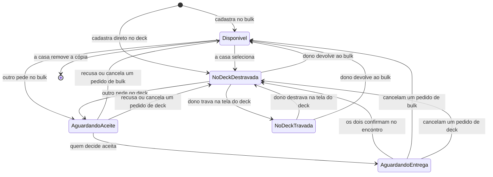

# Spec do backend

O que este repositório precisa implementar para sustentar o app descrito em [conceito.md](conceito.md). A interface não faz parte daqui. A pasta `docs/` é documentação do produto; `GET /docs` da API continua sendo o Swagger do FastAPI.

## Stack

- Python 3.13, FastAPI, Pydantic, SQLAlchemy 2 assíncrono, Alembic, PostgreSQL, UV.
- Testes com pytest. Estilo já exigido por Ruff e Mypy.
- Prefixo `/api/v1`.
- Dinheiro em centavos, inteiro. R$ 10 são `1000`. Nunca `float`.
- Auth no Supabase. Domínio (usuários, grupos, cartas, decks, pedidos) no PostgreSQL deste serviço.

Variáveis novas, no mesmo padrão de `app/core/config.py`: URL e chave anônima do Supabase, JWT secret ou JWKS para validar o access token, e a service role só no processo do backend. A service role não vai para o cliente nem para o log.

## Autenticação

O Supabase Auth entra com e-mail e senha. A pessoa é identificada pelo e-mail, único sem diferença de maiúsculas. O `id` em `users` é o `user.id` do Supabase.

Cadastro:

1. E-mail livre.
2. Cria o usuário no Supabase com e-mail e senha.
3. Grava `users` (`id`, `email`, `first_name`, `last_name`, `level`, `created_at`).
4. E-mail duplicado falha o cadastro inteiro, sem deixar usuário no provedor.

Login: o corpo leva `email` e `password`. A resposta de erro é a mesma para e-mail inexistente e senha errada, e não devolve o e-mail. A resposta de sucesso devolve os tokens do Supabase.

Rotas protegidas exigem `Authorization: Bearer`. O backend valida assinatura, emissor e expiração do JWT e carrega o `users` local. Se o token é válido mas a linha local não existe, ela é recriada com o `id`, o e-mail e os nomes do token (`user_metadata`, com o apelido ou o início do e-mail como alternativa). Token sem e-mail não consegue recriar a linha e recebe 401.

Recuperação de senha: o cliente manda o e-mail. O backend só pede o reset ao Supabase se a conta existir, e responde sempre a mesma mensagem.

Troca de senha: `POST /auth/password` com a sessão, `current_password` e `new_password`. Confere a senha atual no provedor e só então grava a nova. Senha atual errada responde 400, para não parecer sessão expirada.

Endpoints:

- `POST /auth/register` com `email`, `password`, `first_name`, `last_name`
- `POST /auth/login` com `email`, `password`
- `POST /auth/refresh` com `refresh_token`
- `POST /auth/forgot-password` com `email`
- `POST /auth/password` com `current_password`, `new_password`
- `GET /me`

`GET /me` devolve `id`, `email`, `first_name`, `last_name` e `created_at`. `PATCH /me` atualiza `first_name` e `last_name`. Nome e sobrenome têm de 1 a 80 caracteres, sem ficar só com espaço. Mensagens de erro que a pessoa lê estão em português.

## Modelo

### users

`id` uuid, `email` único, `first_name`, `last_name`, `level` (0 é admin, 1 é usuário comum, o padrão do cadastro público), `created_at`. O nome fica nesta tabela, não no metadata do Auth: quem está no grupo precisa ler o nome da casa.

O admin é gravado pelo seed (`python -m app.seed`) depois das migrações, e de novo na subida do backend, se o `ADMIN_EMAIL` ainda não existir. Usa `ADMIN_EMAIL` e `ADMIN_PASSWORD` (em desenvolvimento, sem senha configurada, vale `@bulkados1234`) e o nome Admin Bulkados. `POST /admin/users` cria usuário com `email`, `password`, `first_name`, `last_name` e `level` opcional.

### groups

`id`, `name`, `owner_id`, `created_at`.

### group_members

`group_id`, `user_id`, `status` (`invited`, `accepted`), `invited_by`, `created_at`. Único por grupo e usuário.

Dono é membro `accepted`. Só gente `accepted` vê e mexe no grupo.

### catalog_cards

Acervo das cartas do Scryfall, uma linha por Oracle ID. Não é a cópia física. É carregado inteiro pela atualização do acervo (veja `catalog_sync`); antes da primeira carga, a busca ainda grava aqui o que encontra no Scryfall.

`oracle_id` único, `name_en`, `name_pt` nulo se o Scryfall não tiver impressão em português, `search_en` e `search_pt` (o nome sem acento, em minúsculas e sem pontuação, indexados para a busca por prefixo), `mana_cost` nulo, `image_url` nulo (a imagem `normal` do Scryfall, só o link), `type_line`, `oracle_text`, `color_identity`, `keywords`, `is_basic`, `any_number_allowed`, `commander_legal` (`legal`, `banned`, `not_legal`), `can_be_commander`, `partner_kind` nulo ou um de `partner`, `partner_with`, `friends_forever`, `background`, `choose_a_background`, `doctors_companion`.

`can_be_commander` é verdadeiro só para carta lendária: criatura lendária ou carta lendária cujo texto permite ser comandante. O pareamento (Partner, Background, etc.) fica em `partner_kind`, lido das keywords e do oracle text em inglês do Scryfall. A interface mostra o nome em português quando existir e o nome em inglês como alternativa.

### catalog_sync

Uma única linha (`id = 1`) com o estado da atualização do acervo: `interval_days` (padrão 90), `last_synced_at` nulo até a primeira carga, `running_since` (preenchido enquanto uma atualização roda, e dado como morto depois de 1 hora) e `last_error` (o último erro, ou nulo).

### card_copies

Uma linha por papel.

`id`, `catalog_card_id`, `holder_id` (a casa), `added_by_id`, `price_cents` nulo se o preço não veio, `price_fetched_at`, `state` (`available`, `reserved`, `in_deck`), `locked`, `deck_id` nulo, `created_at`.

Land básica grava `price_cents = 0` e não chama o provedor de preço. Básicas: Plains, Island, Swamp, Mountain, Forest, Wastes e as snow-covered equivalentes.

Invariantes:

- `available`: `deck_id` nulo, `locked` falso, nenhum pedido aberto.
- `reserved`: `locked` verdadeiro, um único pedido aberto.
- `in_deck`: `deck_id` preenchido com deck do detentor atual depois da confirmação. Durante um pedido que saiu de um deck, a cópia pode continuar naquele deck até a confirmação; o estado fica `reserved` e o pedido guarda o deck de origem. `deck_id` na cópia, nesse intervalo, continua o deck de origem.

Uma cópia tem no máximo um pedido aberto. Índice único parcial em `card_copy_id` onde o pedido está aberto.

### card_copy_groups

`card_copy_id`, `group_id`. A cópia aparece nesses grupos. A trava não é por linha: é a da cópia.

O detentor da casa é membro `accepted` de cada grupo vinculado. Ao sair do grupo, apagam-se os vínculos daquele grupo para toda cópia cuja casa é quem saiu; a cópia continua no deck dela e nos outros grupos.

### decks

`id`, `owner_id`, `name`, `format` (`commander_10`, `commander_100`, `commander_200`, `commander_500`, `competitive`), `created_at`.

O deck é da pessoa, não do grupo. Um deck pode reunir cartas de vários bulks e continua existindo quando a pessoa sai de um grupo, entra em outro ou quando o grupo é apagado. Único dono.

### deck_cards

`deck_id`, `card_copy_id` único (uma cópia, um deck), `role` (`commander`, `main`).

A cópia em `deck_cards` é a que está de fato no deck. Pedido ainda não confirmado não cria linha aqui.

### requests

`id`, `card_copy_id`, `group_id`, `requester_id`, `holder_id`, `source` (`bulk`, `deck`), `source_deck_id` nulo, `target_deck_id`, `as_commander`, `status` (`pending_acceptance`, `awaiting_handoff`, `completed`, `cancelled`, `rejected`), `requester_confirmed_at`, `holder_confirmed_at`, `created_at`, `resolved_at`.

Pedidos de bulk e de deck nascem `pending_acceptance`. No bulk, quem decide é a casa física da carta; num pedido que saiu de um deck, quem decide é o dono do deck de origem.

`target_deck_id` é um deck do solicitante, em qualquer grupo dele. O pedido guarda o `group_id` em que foi aberto para aparecer nas listas de encontro daquele grupo.

## Estados da cópia

Transições concorrentes usam `SELECT … FOR UPDATE` na cópia. A segunda solicitação da mesma cópia responde 409.

Reservar trava a cópia em todos os `card_copy_groups`. Não existe trava por grupo. Reservar não é a mesma coisa que o dono travar o deck: a reserva vem de um pedido aberto; a trava é uma decisão do dono.

## Regras de negócio

### Grupos

- Criar grupo cria a membership `accepted` do dono.
- Convidar pelo e-mail. A pessoa precisa existir. Convite repetido ou para quem já é membro responde 409.
- `GET /groups` lista só membership `accepted`. O convite pendente não aparece aí.
- `GET /invitations` lista os convites `invited` de quem está logado: `id` (o id da membership), `group` (`id`, `name`), `invited_by` (`id`, `email`, `first_name`, `last_name`), `created_at`.
- Aceitar e recusar só a própria convidada, usando esse `id`. Recusar apaga o convite. Antes do aceite, a pessoa não lê o grupo.
- Renomear só o dono.
- Sair:
  - o deck não é do grupo: decks de quem saiu continuam existindo, com as cartas que estiverem neles;
  - cartas cuja casa é quem saiu perdem só o vínculo com aquele grupo; continuam nos outros grupos e no deck em que estiverem;
  - pedidos abertos naquele grupo em que quem sai é solicitante ou casa são cancelados; na volta, a cópia fica `available` ou volta ao deck de origem, conforme a fonte;
  - se quem saiu é o dono e ainda há membros, o membro `accepted` mais antigo vira dono;
  - se era o último membro, o grupo é apagado, junto com convites e vínculos; os decks das pessoas continuam.

Não há expulsão. Quem fica com o papel é quem sai, pelos vínculos acima.

### Cadastrar no bulk

Corpo: `oracle_id` (a carta do acervo, achada por ele; 404 se não existir), `quantity`, `holder_id` opcional (a casa) e `group_ids` opcional.

A casa padrão é o usuário atual. Outra casa tem de ser membro `accepted` dos grupos escolhidos. Quem cadastra também. Os grupos escolhidos ficam em `card_copy_groups`. `group_ids`, quando vem, é a lista exata. Se a casa é o próprio usuário e ele não manda grupos, vincula todos os grupos dele. Se a casa é outra pessoa e ele não manda grupos, vincula só o grupo da URL.

Quantidade cria N cópias iguais, cada uma com o preço daquela consulta. Uma falha de preço não desfaz o cadastro: `price_cents` fica nulo.

Cópia nasce `available`.

### Adicionar no deck

Corpo: `oracle_id` e `quantity`; o deck vem da URL. Primeiro coloca no deck, sem travar, as cópias `available` dessa carta cuja casa é quem adiciona, da mais antiga para a mais nova. Se faltar, cadastra o resto já no deck. Todas ficam `in_deck`, `locked` falso, com `role` `main`. As cadastradas aqui também vinculam os grupos da casa. Ficam livres de novo se forem devolvidas ao bulk. Recusa com 409 se a identidade de cor da carta não cabe na do deck.

### Editar o deck em bulk

`PUT /decks/{id}/bulk` `{ cards: [{ name, role }] }` substitui a lista inteira do deck por nomes. `role` é `commander` ou `main` e `name` é comparado com `name_en` e `name_pt`, sem acento e sem diferenciar maiúsculas.

Todos os nomes são resolvidos antes de qualquer escrita. Se um nome não existir, responde 422 listando os nomes e o deck fica intacto. A lista pode repetir nomes, criando uma cópia por linha. Cópias que continuam no deck são reaproveitadas; as que saíram voltam ao bulk; as novas usam primeiro as cópias `available` da casa e o restante é cadastrado já no deck.

A validação dos comandantes é a mesma de `POST /decks/{id}/commanders`, incluindo a identidade de cor das outras cartas. Cópia com pedido aberto não pode sair do deck e a resposta é 409. A resposta é o detalhe do deck (`GET /decks/{id}`).

### Compartilhar com outro grupo

Cópia `available`, casa igual ao usuário, grupo destino em que ele é membro e a cópia ainda não está. Cria o vínculo. Cópia reservada não ganha vínculo. Cópia em deck pode ganhar o vínculo e continua no mesmo estado de trava.

`DELETE /copies/{id}/groups/{group_id}` tira o vínculo de um grupo. Só a casa. Reservada responde 409. O último grupo responde 409: apagar de todos é `DELETE /copies/{id}`. Se a cópia está num deck, responde 409 até ser devolvida ao bulk.

### Selecionar

Cópia `available`, `holder_id` igual ao usuário. Vai para `in_deck`, destravada. Sem linha de pedido. A rota continua `POST /decks/{id}/take`, com `card_copy_id` e `as_commander` opcional. Sem `as_commander`, o `role` é `main` e a identidade de cor segue a dos comandantes atuais. Com `as_commander`, o `role` é `commander` e vale a mesma recusa de marcar comandante: carta inelegível, dupla inválida, mais de dois, ou carta do deck que ficaria fora da identidade nova. Nesse caso a identidade antiga não barra um parceiro de outra cor.

### Solicitar a partir do bulk

Cópia `available`, vinculada ao grupo, casa diferente do solicitante, deck destino do solicitante. Cria pedido `source=bulk`, `pending_acceptance`. Cópia vai para `reserved`, travada.

Quem está com a carta aceita: status `awaiting_handoff`. Recusa: status `rejected`, cópia volta a `available`, sem deck, destravada. Quem pediu cancela enquanto o pedido está aberto, com a mesma volta.

### Solicitar a partir de um deck

Cópia `in_deck`, `locked` falso, vinculada ao grupo, deck atual de outra pessoa, deck destino do solicitante. Cria pedido `source=deck`, `pending_acceptance`, guarda `source_deck_id`. Cópia vai para `reserved`, travada. A linha em `deck_cards` permanece até a confirmação.

Dono do deck de origem aceita: status `awaiting_handoff`. Recusa: status `rejected`, cópia volta a `in_deck` destravada no deck de origem.

### Cancelar

Só o solicitante, com pedido `pending_acceptance` ou `awaiting_handoff`.

- Veio do bulk: cópia `available`, sem deck, destravada.
- Veio de deck: cópia `in_deck` no `source_deck_id`, destravada.

### Confirmar recebimento

Cada lado confirma no encontro, só em `awaiting_handoff`: o solicitante confirma o recebimento e o detentor atual confirma a entrega. Cada confirmação grava `requester_confirmed_at` ou `holder_confirmed_at`. O pedido só muda de mão quando os dois estão preenchidos.

Na confirmação final:

- `holder_id` passa a ser o solicitante;
- some do deck de origem, se havia;
- entra no `target_deck_id` como `main` ou `commander` conforme `as_commander`, `in_deck`, destravada;
- vínculos de grupo cuja casa nova não é membro são apagados;
- garante vínculo com o grupo do deck destino e com os outros grupos da casa nova;
- pedido `completed`.

### Mover entre decks seus

Cópia `in_deck` num deck do usuário, sem pedido aberto, deck destino também do usuário, em qualquer bulk. Troca `deck_id` e a linha de `deck_cards`; os vínculos de grupo não mudam. O corpo leva `target_deck_id` e `as_commander` opcional. Sem ele, comandante no deck antigo volta a `main` no destino. Com ele, entra como `commander` se a cadeira no destino for válida, pelas mesmas regras de marcar comandante.

### Devolver ao bulk

Cópia `in_deck` de um deck do usuário, sem pedido aberto. Sai do deck, `available`, destravada. A casa não muda. Segue vinculada aos grupos atuais.

### Travar e destravar

Só o dono do deck, cópia `in_deck`, sem pedido aberto, e só por essas rotas. O bulk não trava nem destrava. Destravar permite solicitação. Travar impede.

### Remover cópia

Só a casa, só `available`. Apaga vínculos, a cópia e nada de deck. Pedido encerrado antigo pode ficar para histórico ou ser apagado em cascata; pedido aberto não existe nesse estado.

### Marcar comandante

O dono do deck define quais cartas do deck têm `role=commander`. O backend recusa com 409 a carta que não é lendária ou que não pode ser comandante e o par que não é válido (Partner com Partner, Partner with citando o outro, Friends forever, Choose a Background com Background, Doctor com Doctor's companion). Mais de dois comandantes também. Recusa com 409, listando as cartas, se alguma outra carta do deck ficaria fora da identidade de cor dos comandantes escolhidos; a lista vazia sempre vale. As outras regras do deck seguem só como aviso na leitura.

Cada carta do deck traz `can_toggle_commander`: marcar (ou tirar) aquela carta deixaria o conjunto de comandantes válido? A tela usa isso para oferecer o botão.

A identidade de cor do deck é a união da dos comandantes e vem em `color_identity` (na ordem branco, azul, preto, vermelho, verde; lista vazia é incolor; nulo é deck sem comandante) e `color_identity_name`. Ao adicionar, selecionar do bulk, mover ou solicitar uma carta para um deck com comandante, a carta cuja identidade sai da do deck é recusada com 409.

## Avisos do deck

Calculados na leitura. Nada é persistido além das cartas e do formato. Nenhum aviso impede escrita.

Sempre:

- `deck_over_100` se a quantidade, comandantes inclusos, for maior que 100;
- `deck_under_100` se for menor que 100;
- `duplicate_name` por nome inglês extra, exceto land básica e `any_number_allowed`;
- `color_identity` quando a identidade da carta não cabe na união da identidade dos comandantes;
- `banned` quando `commander_legal` é `banned`;
- `commander_illegal` quando um comandante não é lendário, ou tem `can_be_commander` falso e o `partner_kind` não sustenta a cadeira (Background entra como segundo comandante, não como criatura lendária);
- `commander_pairing` quando há zero comandantes, ou mais de um sem combinação válida.

Combinação válida:

- um comandante lendário com `can_be_commander`;
- dois com `partner`;
- dois com `partner_with` cujos textos se apontam;
- dois com `friends_forever`;
- um com `choose_a_background` e um com `background`;
- um Doctor (criatura lendária que é o Doctor, marcada no oracle/keywords) e um com `doctors_companion`.

Identidade de cor com dois comandantes é a união das duas. Sem comandante, o aviso de cor fica de fora e entra `commander_pairing`.

Preço, só avisos:

- `missing_price` se alguma carta não básica tem `price_cents` nulo. Ela não entra na soma.
- Commander 10: `budget_main` se a soma das `main` passa de `1000`; `budget_commanders` se a soma dos `commander` passa de `500`.
- Competitivo: sem aviso de teto.
- Commander 100, 200 e 500: sem aviso de teto até as regras existirem. O formato já é gravado. O cálculo de preço fica num ponto só, por formato, para preencher depois sem migrar deck.

A resposta do deck inclui `card_count`, `main_price_cents`, `commander_price_cents` e a lista de avisos (`code`, `card_copy_id` opcional, `message`).

## Catálogo e preço

Busca: `GET /catalog/cards?q=`. Lê o acervo local, sem chamar o Scryfall. O termo é normalizado (sem acento, minúsculas, sem pontuação) e procurado nos nomes em inglês e em português. A ordem é: nome igual ao termo, nome que começa com o termo, nome com uma palavra que começa com o termo. No máximo 20 itens. Com `deck_id` (um deck do próprio usuário), só entram cartas cuja identidade de cor cabe na do deck. Cada item traz `id`, `oracle_id`, `name_en`, `name_pt`, `mana_cost`, `image_url`, `type_line`, `color_identity` e `is_basic`. Enquanto o acervo nunca foi carregado, a busca ainda consulta o Scryfall ao vivo, em inglês e em português, e grava o que encontra.

Atualização do acervo: a carga lê o arquivo `oracle_cards` do Scryfall (uma carta por Oracle ID, só cartas de jogo que existem em papel ou no MTGO) e os nomes em português pela busca paginada `lang:pt`. Repetir a carga só atualiza: nunca troca o `id` nem apaga carta, então as cópias seguem apontando para a carta certa. Ela roda na primeira subida do backend e depois sempre que `interval_days` vence (conferência a cada 6 horas), em segundo plano. User-Agent identificável, intervalo entre requisições abaixo de 10 por segundo, e o 429 do Scryfall é tratado esperando o `Retry-After`.

Endpoints de administração (nível 0, fora do `/docs`, o frontend não chama):

- `GET /admin/catalog/sync`: `interval_days`, `last_synced_at`, `running`, `last_error`.
- `POST /admin/catalog/sync-interval` `{ "days": 1 a 3650 }`.
- `POST /admin/catalog/sync`: força a atualização. 202, ou 409 se já houver uma rodando.

Preço: porta interna `PriceProvider.lowest_brl_cents(name_en) -> int | None`. A implementação de referência é o menor preço da LigaMagic. Não há API pública oficial; o adaptador fica atrás dessa porta e só entra quando a forma de acesso for permitida pela LigaMagic. Sem adaptador, o método devolve vazio.

O preço é consultado no cadastro da cópia e pode ser atualizado por `POST /card-copies/{id}/refresh-price`, pela casa ou por quem cadastrou. Land básica ignora e permanece 0.

## Endpoints de domínio

Todos exigem usuário autenticado. Recurso de grupo exige membership `accepted`, senão 404 (o grupo não vaza para quem está fora).

Grupos:

- `POST /groups` `{ name }`
- `GET /groups`
- `PATCH /groups/{id}` `{ name }`
- `POST /groups/{id}/invitations` `{ email }`
- `GET /invitations`
- `POST /invitations/{id}/accept`
- `POST /invitations/{id}/decline`
- `POST /groups/{id}/leave`
- `GET /groups/{id}/members`

Cartas:

- `POST /groups/{id}/copies` cadastra no bulk daquele grupo e pode incluir outros grupos no corpo
- `GET /groups/{id}/copies` lista as cópias vinculadas, com estado visível: livre, reservada (pedido aberto), no deck (com o deck e o dono, quando o dono do deck compartilha algum grupo com quem vê), ou em uso em outro grupo quando o deck está com alguém que não participa de nenhum grupo de quem vê
- `POST /copies/{id}/groups` `{ group_id }` inclui num grupo
- `DELETE /copies/{id}/groups/{group_id}` tira de um grupo
- `DELETE /copies/{id}` remove de todos
- `POST /copies/{id}/refresh-price`

Decks:

- `POST /decks` `{ name, format }` cria um deck da pessoa
- `GET /decks` lista os decks da pessoa, em qualquer bulk, com a contagem de cartas
- `POST /groups/{id}/decks` e `GET /groups/{id}/decks` continuam valendo por compatibilidade, mas operam nos decks globais da pessoa
- `GET /decks/{id}` cartas, comandantes, contagens, preços e avisos
- `PATCH /decks/{id}` nome ou formato
- `DELETE /decks/{id}` devolve as cartas ao bulk, livres, na casa atual
- `POST /decks/{id}/commanders` `{ card_copy_ids }` substitui o conjunto de comandantes; 409 se a escolha não é válida
- `PUT /decks/{id}/bulk` `{ cards: [{ name, role }] }` substitui a lista pelos nomes; 422 lista nomes desconhecidos e não altera nada
- `POST /decks/{id}/take` `{ card_copy_id, as_commander }` selecionar o que já está na sua casa, sem travar. `as_commander` entra na cadeira de comandante
- `POST /decks/{id}/copies` cadastra direto no deck
- `POST /decks/{id}/cards/{card_copy_id}/move` `{ target_deck_id, as_commander }`
- `POST /decks/{id}/cards/{card_copy_id}/return`
- `POST /decks/{id}/cards/{card_copy_id}/lock`
- `POST /decks/{id}/cards/{card_copy_id}/unlock`

Pedidos:

- `POST /decks/{id}/requests` `{ card_copy_id, group_id?, as_commander? }` escolhe bulk ou deck pelo estado da cópia; aceita pedido de bulk ou de deck
- `POST /requests/{id}/accept`
- `POST /requests/{id}/reject`
- `POST /requests/{id}/cancel`
- `POST /requests/{id}/confirm`
- `GET /groups/{id}/handoffs` duas listas, `to_bring` e `to_receive`, só daquele grupo

`to_bring` são pedidos abertos em que o usuário é a casa atual ou o dono do deck de origem: entram tanto os que ainda esperam a decisão de aceitar/recusar quanto os já aceitos que precisam ser levados. `to_receive` são pedidos abertos em que `requester_id` é o usuário, com o status para a interface mostrar “esperando aceite” ou “esperando a carta”.

### Formato das respostas

É o formato que o frontend valida (`frontend/src/lib/api`). Os testes de `tests/integration/test_contract.py` travam as chaves; mudar um lado sem o outro quebra a tela.

- Cópia (`POST` e `GET /groups/{id}/copies`, `refresh-price`, `take`, `move`, `return`, `lock`, `unlock`, incluir e tirar grupo): `id`, `catalog` (`oracle_id`, `name_en`, `name_pt`, `image_url`, `mana_cost`, `type_line`, `oracle_text`, `color_identity`, `is_basic`, `keywords`, `can_be_commander`, `partner_kind`), `holder` e `added_by` (`id`, `email`, `first_name`, `last_name`), `price_cents`, `price_fetched_at`, `state`, `locked`, `visibility`, `deck` (`id`, `name`, `owner`) ou nulo, `open_request` (`id`, `status`, `source`, `requester`) ou nulo, `group_ids`.
- Deck (`GET` e `PATCH /decks/{id}`): `id`, `name`, `format`, `owner_id`, `color_identity`, `color_identity_name`, `card_count`, `main_price_cents`, `commander_price_cents`, `warnings` e `cards`. Cada carta traz `card_copy_id`, `role`, `locked`, `price_cents`, `holder`, `catalog` (os campos da cópia mais `commander_legal`), `open_request` e `can_toggle_commander`. O resumo do deck (`GET /decks` e o alias por grupo) traz `color_identity`, `color_identity_name`, `card_count` e `commanders` (cada um com `name_en`, `name_pt`, `image_url`, `can_be_commander`, `partner_kind`, `type_line`, `oracle_text` e `keywords`).
- Pedido: `id`, `card_copy_id`, `group_id`, `requester_id`, `requester_email`, `requester_first_name`, `requester_last_name`, `holder_id`, `holder_email`, `holder_first_name`, `holder_last_name`, `source`, `source_deck_id`, `target_deck_id`, `target_deck_name`, `as_commander`, `status`, `requester_confirmed`, `holder_confirmed`, `name_en`, `name_pt`, `created_at`, `resolved_at`.
- Encontros: `to_bring` com `id`, `source`, `catalog` (`name_en`, `name_pt`), `status`, `requester`, `holder`, `target_deck` (`id`, `name`), `requester_confirmed` e `holder_confirmed`; `to_receive` com `id`, `source`, `catalog`, `status`, `holder`, `target_deck`, `requester_confirmed` e `holder_confirmed`.

## Ordem de implementação

1. Usuários, cadastro, login por e-mail, `GET /me`, JWT nas rotas.
2. Grupos, convite, aceite, saída e transferência de dono.
3. Busca no Scryfall e cache `catalog_cards`, com `PriceProvider` devolvendo vazio.
4. Cópias no bulk, vínculo com vários grupos, land básica a preço zero.
5. Decks, selecionar, cadastro direto, comandantes e avisos, incluindo o orçamento do Commander 10.
6. Pedidos, trava global, listas do encontro, confirmar e cancelar.
7. Mover, devolver, travar, destravar, compartilhar, remover, sair do grupo preservando os decks.
8. Adaptador de preço da LigaMagic, quando houver acesso permitido. Até lá o aviso `missing_price` é o comportamento esperado.

Cada etapa entra com teste do caso feliz e do conflito que a regra cita (e-mail repetido, convite sem aceite, segunda solicitação 409, trava vista por outro grupo, saída preservando o deck, Commander 10 estourado gera aviso e persiste o deck).

## Fora deste serviço

Interface, push, e-mail de convite além do reset de senha do Supabase, pagamento, e o número dos tetos de Commander 100, 200 e 500.

## Pendência de produto

Os tetos de Commander 100, 200 e 500 ainda vão ser definidos. Até lá o backend grava o formato, avisa tamanho e regras de Commander, e não avisa preço nesses três. O Commander 10 permanece em R$ 10 nas cartas do deck e R$ 5 na soma dos comandantes.
